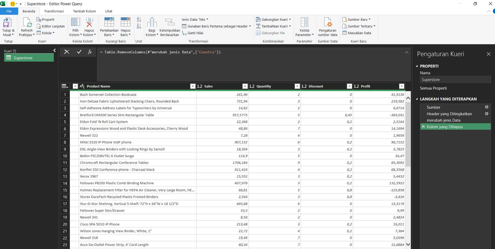
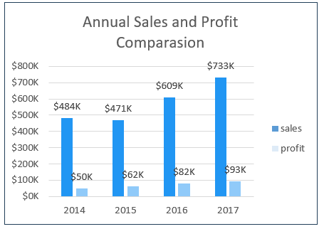
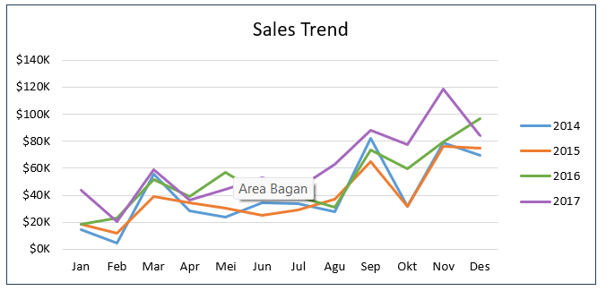
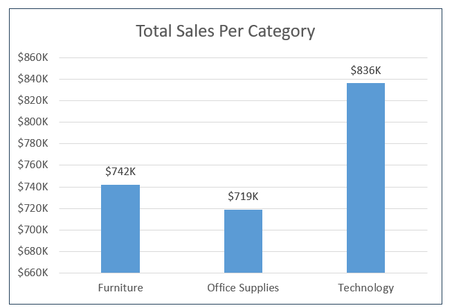
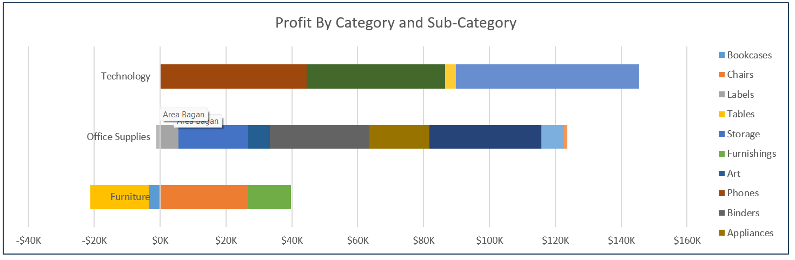
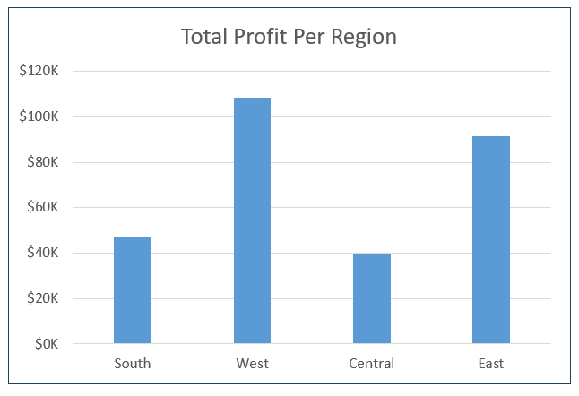
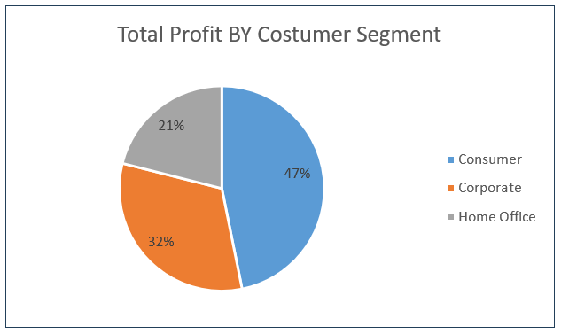
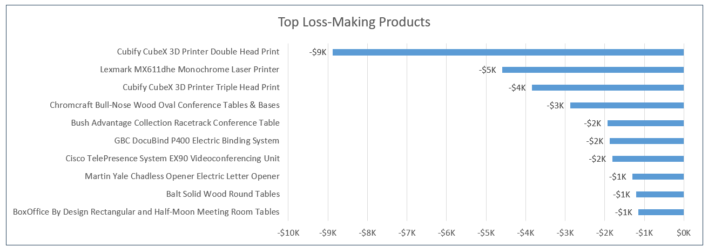
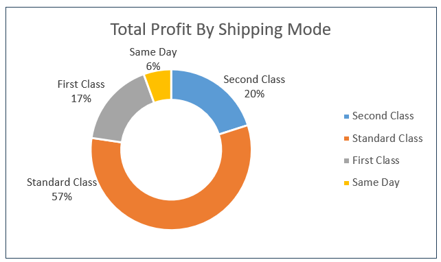

# 📊 Superstore Business Performance Overview

Dashboard interaktif Microsoft Excel untuk mengeksplorasi kinerja penjualan dan profit pada dataset Superstore.

[<video src="resource/vidio/utama.mp4" controls width="800"></video>](https://github.com/user-attachments/assets/fd59422f-bcc4-4e58-94b0-ed47b841a28c)

## Daftar Isi

- [Tentang Proyek](#tentang-proyek)
- [Pertanyaan Analisis](#pertanyaan-analisis)
- [Tools dan Keterampilan](#tools-dan-keterampilan)
- [Struktur Workbook](#struktur-workbook)
- [Proses ETL dengan Power Query](#proses-etl-dengan-power-query)
- [Perhitungan KPI](#perhitungan-kpi)
- [Hasil Analisis dan Insight](#hasil-analisis-dan-insight)
- [Kesimpulan dan Rekomendasi](#kesimpulan-dan-rekomendasi)

## Tentang Proyek

Proyek ini berfokus pada pembuatan dashboard interaktif menggunakan Microsoft Excel untuk menganalisis kinerja penjualan dan profit berdasarkan dataset Superstore. Pengguna dapat mengeksplorasi hasil melalui filter tahun, kategori produk, wilayah, dan segmen pelanggan.

Dashboard menyajikan indikator kinerja utama (*Key Performance Indicators* atau KPI) serta beberapa visualisasi untuk membantu membaca tren penjualan, membandingkan kontribusi produk dan wilayah, memahami kontribusi segmen pelanggan, dan menemukan area bisnis yang perlu ditinjau lebih lanjut.

### 🎯 Tujuan Proyek

- Menyiapkan data transaksi agar dapat digunakan untuk analisis.
- Menghitung KPI penjualan dan profit dengan formula Excel.
- Menyajikan pola serta perbandingan data melalui visualisasi.
- Membuat dashboard yang dapat dieksplorasi menggunakan filter interaktif.
- Mengubah hasil visualisasi menjadi insight dan pertanyaan tindak lanjut untuk bisnis.

## Pertanyaan Analisis

🧩 Analisis disusun untuk menjawab lima pertanyaan berikut. Setiap pertanyaan dibahas kembali pada bagian hasil analisis agar temuan dan implikasi bisnisnya saling terhubung.

1. 🗓️ **Bagaimana perubahan penjualan dan profit dari waktu ke waktu?**
2. 🛍️ **Kategori dan subkategori produk apa yang menonjol dari sisi penjualan dan profit?**
3. 🌎 **Wilayah mana yang memberikan kontribusi profit terbesar dan terkecil?**
4. 👥 **Segmen pelanggan mana yang memberikan kontribusi profit terbesar?**
5. 🧭 **Area bisnis mana yang perlu dievaluasi lebih lanjut berdasarkan produk yang merugi dan kontribusi metode pengiriman?**

> **Batasan interpretasi:** visualisasi wilayah yang tersedia pada workbook membandingkan profit, bukan penjualan wilayah. Visualisasi segmen pelanggan dan metode pengiriman juga menampilkan proporsi profit. Karena itu, bagian analisis tidak menyimpulkan peringkat penjualan berdasarkan wilayah maupun efisiensi biaya pengiriman yang belum ditampilkan oleh grafik.

## Tools dan Keterampilan

- **Microsoft Excel** — pengolahan data, formula, KPI, grafik, dan dashboard.
- **Power Query** — proses *Extract, Transform, Load* (ETL), termasuk penyesuaian tipe data.
- **Formula dan fungsi Excel** — agregasi, penyaringan data, penghitungan pesanan unik, dan perhitungan rasio.
- **Data Validation** — menyediakan pilihan filter melalui dropdown.
- **Visualisasi data** — grafik kolom, grafik garis, diagram lingkaran, dan diagram donat.
- **Dashboard interaktif** — menampilkan KPI dan grafik berdasarkan filter yang dipilih.
- **VBA (Visual Basic for Applications)** — mendukung interaksi grafik dan tombol *Reset Filter*.

## Struktur Workbook

| Worksheet | Fungsi |
|---|---|
| `Dashboard` | Menampilkan KPI, visualisasi, dan filter interaktif. |
| `Superstore` | Menyimpan data transaksi utama. |
| `Product` | Mendukung analisis berdasarkan produk. |
| `KPI` | Menyediakan perhitungan indikator kinerja utama. |
| `Bagan` | Menyediakan data pendukung grafik. |
| `Data_Validation` | Menyimpan daftar referensi untuk dropdown filter. |

Nama worksheet di atas mengikuti struktur workbook proyek.

## Proses ETL dengan Power Query

### 1. 📥 Extract — Pengambilan Data

Dataset Superstore diimpor ke Microsoft Excel menggunakan Power Query. Data hasil impor menjadi sumber untuk analisis penjualan, profit, kuantitas, diskon, dan tanggal transaksi.

### 2. 🧹 Transform — Transformasi Data

Beberapa kolom awalnya terbaca sebagai teks (*Text*), padahal diperlukan sebagai angka atau tanggal. Tipe data kolom `Sales`, `Profit`, `Quantity`, `Discount`, `Order Date`, dan `Ship Date` disesuaikan dengan karakteristik datanya.

Saat kolom tanggal dikonversi, Power Query menghasilkan nilai `Error`. Masalah tersebut berkaitan dengan perbedaan format tanggal pada data sumber dan pengaturan lokal (*locale*) yang digunakan untuk membacanya. Konversi kemudian menggunakan lokal `en-US`, sesuai format sumber data.

```powerquery
= Table.TransformColumnTypes(
    #"Header yang Ditingkatkan",
    {
        {"Sales", type number},
        {"Profit", type number},
        {"Quantity", type number},
        {"Discount", type number},
        {"Order Date", type date},
        {"Ship Date", type date}
    },
    "en-US"
)
```

Kolom `Country` juga dihapus karena pada dataset ini seluruh nilainya adalah `United States`. Dengan tidak adanya variasi negara, kolom tersebut tidak membantu perbandingan antarnegara.

```powerquery
= Table.RemoveColumns(#"merubah jenis Data", {"Country"})
```

### 3. 📤 Load — Pemuatan Data

Setelah transformasi selesai, data dimuat ke workbook Excel untuk digunakan dalam perhitungan KPI dan visualisasi.



## Perhitungan KPI

📌 KPI digunakan untuk memberikan ringkasan kinerja berdasarkan filter yang dipilih. Formula berikut menggunakan nama rentang `category`, `region`, `segment`, dan `year` sebagai referensi sel filter. Pemisah argumen berupa titik koma mengikuti pengaturan Excel yang digunakan.

### 💰 Total Sales

```excel
=SUMIFS(
    superstore[Sales];
    superstore[Category]; IF(category="All"; "<>"; category);
    superstore[Region]; IF(region="All"; "<>"; region);
    superstore[Segment]; IF(segment="All"; "<>"; segment);
    superstore[Order Date]; IF(year="All"; ">="&DATE(1900;1;1); ">="&DATE(year;1;1));
    superstore[Order Date]; IF(year="All"; "<>"; "<="&DATE(year;12;31))
)
```

### 📈 Total Profit

```excel
=SUMIFS(
    superstore[Profit];
    superstore[Category]; IF(category="All"; "<>"; category);
    superstore[Region]; IF(region="All"; "<>"; region);
    superstore[Segment]; IF(segment="All"; "<>"; segment);
    superstore[Order Date]; IF(year="All"; ">="&DATE(1900;1;1); ">="&DATE(year;1;1));
    superstore[Order Date]; IF(year="All"; "<>"; "<="&DATE(year;12;31))
)
```

### 🧾 Total Orders

Total pesanan dihitung sebagai jumlah `Order ID` unik setelah data difilter berdasarkan kategori, wilayah, segmen, dan tahun.

```excel
=IFERROR(
    COUNTA(
        UNIQUE(
            FILTER(
                superstore[Order ID];
                ((category="All")+(superstore[Category]=category))*
                ((region="All")+(superstore[Region]=region))*
                ((segment="All")+(superstore[Segment]=segment))*
                ((year="All")+(YEAR(superstore[Order Date])=year))
            )
        )
    );
    0
)
```

### 📊 Profit Margin

```excel
=Total_Profit/Total_Sales
```

Profit margin menunjukkan perbandingan profit terhadap penjualan. Untuk menghindari pembagian dengan nol, pastikan penanganan kondisi `Total_Sales = 0` sesuai kebutuhan workbook.

### 🏷️ Average Discount

```excel
=AVERAGEIFS(
    superstore[Discount];
    superstore[Category]; IF(category="All"; "<>"; category);
    superstore[Region]; IF(region="All"; "<>"; region);
    superstore[Segment]; IF(segment="All"; "<>"; segment);
    superstore[Order Date]; IF(year="All"; ">="&DATE(1900;1;1); ">="&DATE(year;1;1));
    superstore[Order Date]; IF(year="All"; "<>"; "<="&DATE(year;12;31))
)
```

> Catatan: formula di atas mendokumentasikan pola perhitungan KPI yang digunakan. Periksa kembali nama rentang, nama tabel, serta hasil untuk kondisi filter `All` di file Excel sebelum menggunakan formula sebagai contoh implementasi final.

## Hasil Analisis dan Insight

📊 Bagian berikut menjawab pertanyaan analisis berdasarkan grafik dalam workbook. Angka merupakan pembacaan perkiraan dari visualisasi yang tersedia.

### 🗓️ 1. Bagaimana perubahan penjualan dan profit dari waktu ke waktu?

#### 📈 Penjualan dan Profit Tahunan



**🔍 Temuan utama**

- Penjualan sekitar **$484 ribu pada 2014**, turun sedikit menjadi sekitar **$470 ribu pada 2015**, kemudian meningkat menjadi sekitar **$609 ribu pada 2016** dan **$733 ribu pada 2017**.
- Profit meningkat dari sekitar **$50 ribu pada 2014** menjadi **$62 ribu pada 2015**, **$82 ribu pada 2016**, dan **$93 ribu pada 2017**.
- Tahun 2017 mencatat nilai penjualan dan profit tertinggi dalam periode yang ditampilkan.

**💡 Jadi, apa artinya?**

Secara keseluruhan, kinerja penjualan dan profit menunjukkan tren meningkat pada akhir periode, meskipun penjualan sempat turun pada 2015. Peningkatan profit yang sejalan dengan pertumbuhan penjualan merupakan sinyal positif, tetapi grafik ini saja belum cukup untuk menjelaskan penyebabnya. Perubahan harga, volume penjualan, komposisi produk, diskon, dan biaya masih perlu dianalisis untuk mengetahui faktor pendorongnya.

#### 📅 Tren Penjualan Bulanan



**🔍 Temuan utama**

- Penjualan berfluktuasi dari bulan ke bulan sepanjang periode 2014–2017.
- Kenaikan terlihat pada beberapa periode, termasuk sekitar Maret, September, dan November.
- November 2017 merupakan titik penjualan bulanan tertinggi yang tampak pada grafik.

**💡 Jadi, apa artinya?**

Tren bulanan membantu menunjukkan kapan penjualan relatif tinggi atau rendah. Periode dengan kenaikan penjualan dapat dijadikan titik awal untuk meninjau promosi, pola permintaan, dan ketersediaan stok. Namun, pola tersebut belum membuktikan adanya musiman; diperlukan data beberapa tahun dan pengujian lebih lanjut untuk membedakan pola berulang dari fluktuasi biasa.

### 🛍️ 2. Kategori dan subkategori produk apa yang menonjol dari sisi penjualan dan profit?

#### 📦 Penjualan Berdasarkan Kategori Produk



**🔍 Temuan utama**

- **Technology** memiliki total penjualan tertinggi, sekitar **$836 ribu**.
- **Furniture** berada di urutan berikutnya, sekitar **$742 ribu**.
- **Office Supplies** mencatat penjualan sekitar **$719 ribu**.

**💡 Jadi, apa artinya?**

Technology merupakan kategori dengan penjualan terbesar pada visualisasi ini. Meski demikian, penjualan tertinggi tidak otomatis berarti profit tertinggi. Karena itu, perbandingan penjualan perlu dibaca bersama grafik profit agar keputusan bisnis tidak hanya berfokus pada besarnya pendapatan.

#### 💹 Profit Berdasarkan Kategori dan Subkategori



**🔍 Temuan utama**

- Kategori **Technology** menunjukkan kontribusi profit positif yang besar.
- Profit pada subkategori **Office Supplies** bervariasi.
- Kategori **Furniture** memiliki variasi profit antar-subkategori, termasuk subkategori dengan profit negatif.

**💡 Jadi, apa artinya?**

Analisis pada tingkat subkategori memberi gambaran yang lebih terperinci dibandingkan total kategori. Subkategori dengan profit negatif perlu ditinjau berdasarkan harga jual, diskon, biaya, dan volume transaksi. Sementara itu, subkategori dengan profit positif dapat dianalisis lebih lanjut untuk memahami faktor yang mendukung kinerjanya. Grafik yang tersedia tidak mencantumkan angka rinci setiap subkategori dalam README ini, sehingga tidak digunakan untuk menyatakan urutan subkategori tertentu.

### 🌎 3. Wilayah mana yang memberikan kontribusi profit terbesar dan terkecil?



**🔍 Temuan utama**

- **West** menghasilkan profit tertinggi, sekitar **$108 ribu**.
- **East** berada di urutan kedua, sekitar **$91 ribu**.
- **South** menghasilkan profit sekitar **$47 ribu**.
- **Central** menghasilkan profit terendah di antara wilayah yang ditampilkan, sekitar **$40 ribu**.

**💡 Jadi, apa artinya?**

West dan East merupakan kontributor profit terbesar pada grafik. Central dan South layak ditinjau lebih lanjut untuk memahami perbedaan hasil, misalnya melalui perbandingan jumlah pesanan, kategori produk, tingkat diskon, serta komposisi pelanggan. Hasil ini menunjukkan kontribusi profit, bukan secara langsung efisiensi atau potensi pertumbuhan wilayah. Visualisasi penjualan per wilayah tidak tersedia pada bagian ini, sehingga kesimpulan dibatasi pada profit.

### 👥 4. Segmen pelanggan mana yang memberikan kontribusi profit terbesar?



**🔍 Temuan utama**

- **Consumer** menyumbang sekitar **47%** dari total profit.
- **Corporate** menyumbang sekitar **32%**.
- **Home Office** menyumbang sekitar **21%**.

**💡 Jadi, apa artinya?**

Consumer merupakan kontributor profit terbesar di antara tiga segmen yang ditampilkan. Hasil ini membantu menentukan segmen yang perlu dipahami lebih dalam, tetapi belum menunjukkan segmen dengan nilai penjualan, jumlah pelanggan, atau profit per pesanan tertinggi. Analisis lanjutan dapat membandingkan metrik tersebut agar strategi untuk tiap segmen didasarkan pada lebih dari satu ukuran.

### 🧭 5. Area bisnis mana yang perlu dievaluasi berdasarkan produk yang merugi dan kontribusi metode pengiriman?

#### 📉 Produk dengan Kerugian Tertinggi



**🔍 Temuan utama**

- **Cubify CubeX 3D Printer Double Head Print** mencatat kerugian terbesar, sekitar **$9 ribu**.
- **Lexmark MX611dhe Monochrome Laser Printer** berada di urutan berikutnya, dengan kerugian sekitar **$5 ribu**.
- Grafik juga menunjukkan produk lain yang mengalami profit negatif.

**💡 Jadi, apa artinya?**

Produk dengan kerugian terbesar merupakan kandidat untuk ditinjau lebih lanjut. Pemeriksaan dapat mencakup besaran diskon, harga jual, biaya perolehan, biaya pemenuhan pesanan, serta kemungkinan retur atau pola transaksi tertentu. Kerugian pada grafik tidak menjelaskan penyebabnya secara langsung, sehingga pengurangan diskon atau penghentian produk sebaiknya tidak diputuskan hanya berdasarkan visualisasi ini.

#### 🚚 Kontribusi Profit Berdasarkan Metode Pengiriman



**🔍 Temuan utama**

- **Standard Class** menyumbang sekitar **57%** dari total profit.
- **Second Class** menyumbang sekitar **20%**.
- **First Class** menyumbang sekitar **17%**.
- **Same Day** menyumbang sekitar **6%**.

**💡 Jadi, apa artinya?**

Standard Class memberikan kontribusi profit terbesar pada visualisasi. Namun, persentase kontribusi ini belum membuktikan bahwa Standard Class paling efisien atau paling menguntungkan per pesanan. Kontribusi tersebut dapat dipengaruhi oleh banyaknya pesanan yang menggunakan metode itu. Untuk membandingkan efisiensi, diperlukan data tambahan seperti jumlah pesanan, biaya pengiriman, waktu pengiriman, dan profit rata-rata per pesanan.

## Kesimpulan dan Rekomendasi

🧠 Berdasarkan visualisasi yang tersedia, beberapa kesimpulan utama dari proyek ini adalah:

1. **Kinerja dari waktu ke waktu:** penjualan dan profit mencapai nilai tertinggi pada 2017 dalam periode yang ditampilkan; tren bulanan tetap berfluktuasi.
2. **Kategori produk:** Technology mencatat penjualan tertinggi dan memperlihatkan kontribusi profit positif yang besar. Analisis subkategori diperlukan untuk memahami perbedaan profit di dalam setiap kategori.
3. **Wilayah:** West menjadi kontributor profit terbesar, sedangkan Central menjadi yang terkecil pada grafik wilayah.
4. **Segmen pelanggan:** Consumer menyumbang proporsi profit terbesar.
5. **Peluang evaluasi:** beberapa produk mengalami kerugian, dan kontribusi profit per metode pengiriman perlu dibaca bersama jumlah pesanan serta biaya terkait.

### 🚀 Rekomendasi tindak lanjut

- 🔎 Periksa faktor yang berkaitan dengan kerugian produk, terutama diskon, harga jual, dan biaya.
- ⚖️ Bandingkan kategori dan subkategori berdasarkan penjualan sekaligus profit, bukan penjualan saja.
- 🗺️ Selidiki perbedaan profit antardaerah melalui komposisi produk, segmen pelanggan, pesanan, dan diskon.
- 🧮 Tambahkan metrik jumlah pesanan serta profit rata-rata untuk memperdalam analisis segmen dan metode pengiriman.
- 📅 Gunakan tren bulanan sebagai dasar pertanyaan lanjutan, lalu verifikasi apakah kenaikan pada bulan tertentu berulang dari tahun ke tahun.

✨ Proyek ini menerapkan Power Query untuk persiapan data, formula Excel untuk KPI, serta visualisasi dan filter interaktif untuk eksplorasi kinerja bisnis. Dashboard menyajikan ringkasan yang dapat membantu pengguna menemukan pola dan menentukan area yang layak diperiksa lebih lanjut, tanpa menganggap korelasi visual sebagai bukti penyebab.
